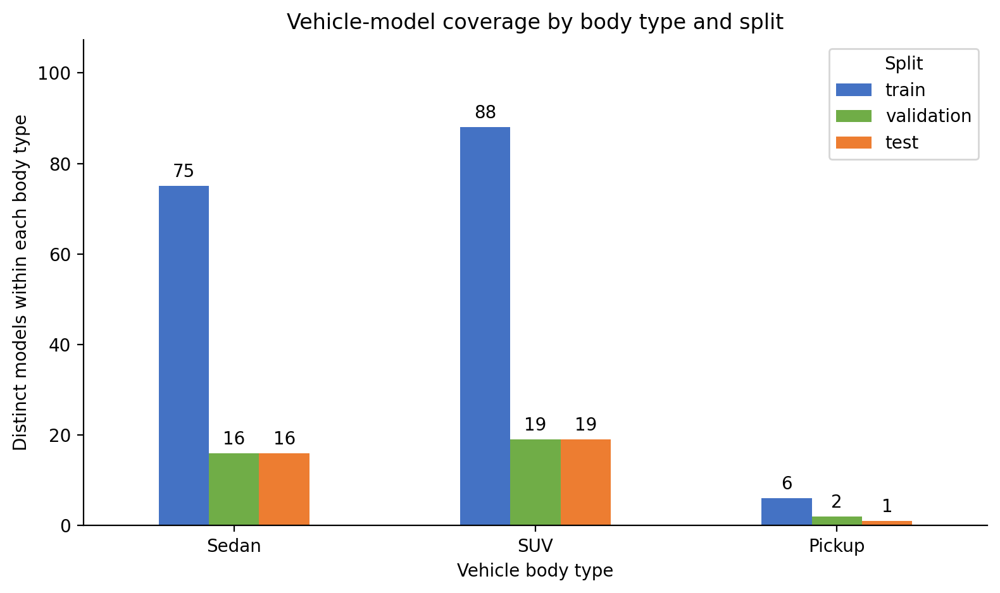

## Explanatory Plots

These figures describe the final cleaned dataset, rather than the
candidate pool examined in MI2.

### Figure 1. Cleaned listings by body type

The cleaned sample contains 395 sedan, 371 SUV, and 94 pickup listings.
Each listing contributes three images, so the image counts have the same
class proportions. Pickups remain substantially less represented,
supporting the use of balanced accuracy and per-class recall.

Underlying counts:
[cleaned_listings_by_body_type.csv](../OUTPUT/cleaned_listings_by_body_type.csv)

### Figure 2. Vehicle-model coverage by body type and split

Pickup model diversity is limited: training includes six pickup models,
validation includes two, and testing includes one. Consequently, pickup
test performance may depend strongly on the particular model held out.

Counts represent distinct Genmodel_ID values within each body type and
split. A model identifier can span multiple body types, so adding counts
across body types may exceed the number of distinct models overall.

Underlying counts:
[vehicle_models_by_body_type_and_split.csv](../OUTPUT/vehicle_models_by_body_type_and_split.csv)

### Reproducing the figures

1. Download split_summary.csv from this DATA folder.
2. Open SCRIPTS/DS4002_Project_3_Data_Exploration.ipynb in Google Colab.
3. Run the notebook's code cell.
4. When prompted, upload split_summary.csv.
5. Both plots will display in the notebook.
6. The notebook saves the two PNG figures, two CSV tables, and package
   version record in the runtime's OUTPUT/ folder.
7. Download and extract Project3_Exploration_Outputs.zip.

The notebook uses pandas and matplotlib. The versions used for the
committed figures are recorded in
[exploration_package_versions.txt](../OUTPUT/exploration_package_versions.txt).

Generated files must be uploaded to the repository's OUTPUT/ folder
manually; running Colab does not update GitHub.
