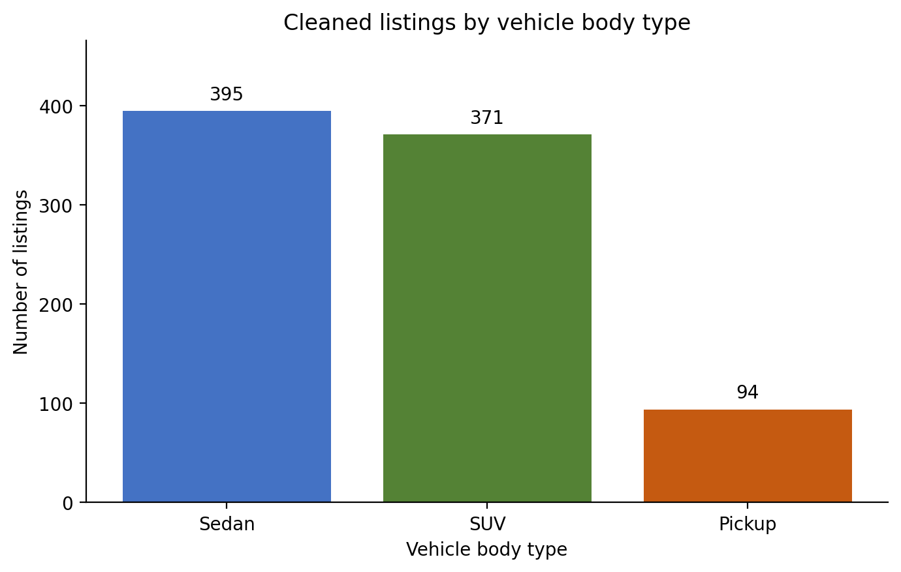

# Data

This folder documents the data used in Vehicle Body-Type Classification
Across Viewing Angles (The Pink Panthers — DS 4002, Project 3).

## Data Summary

We use DVM-CAR vehicle images to compare classification of sedans, SUVs,
and pickup trucks across front, side, and rear views.

The cleaned dataset contains 2,580 images from 860 listings. Each listing
contributes one Front, one Side, and one Rear image. Images are 300 × 300
pixels.

| Split | Listings | Images | Distinct vehicle models |
| --- | ---: | ---: | ---: |
| Training | 595 | 1,785 | 168 |
| Validation | 131 | 393 | 37 |
| Test | 134 | 402 | 36 |
| Total | 860 | 2,580 | 241 |

The sample contains 395 sedan, 371 SUV, and 94 pickup listings.

Splits are grouped by Genmodel_ID so that vehicle models do not overlap
between partitions. Target proportions are 70% training, 15% validation,
and 15% test; actual proportions differ slightly because groups remain intact.

### Accessing the data

Download the named attachments from the
[dataset release](https://github.com/shawnchen17035/DS4002-Project-3/releases/tag/data-v1.0).

| Archive | Purpose |
| --- | --- |
| DVM_Cleaned_Data.zip | Final cleaned images, manifests, and fixed splits |
| DVM_Project3_Review_20261114_201843_029683.zip | Candidate images and selection manifest used as cleaning inputs |
| DVM_Review_Records.zip | Recorded review decisions used as a cleaning input |

To use the cleaned dataset, extract DVM_Cleaned_Data.zip and keep Photos/
alongside the extracted CSV and JSON files. Each Extracted_path is relative
to this extracted folder.

Download the named attachments under Assets, not the automatically generated
Source code archives. Cloning the repository does not download the image
archives.

### Files in this folder

| File | Contents |
| --- | --- |
| clean_manifest.csv | Cleaned image records before split assignment |
| listing_review.csv | Recorded listing review decisions |
| manifest_with_splits.csv | Cleaned image records with split assignments |
| model_split_assignments.csv | Vehicle-model split assignments |
| train_manifest.csv | Training image records |
| validation_manifest.csv | Validation image records |
| test_manifest.csv | Test image records |
| split_config.json | Split parameters and recorded package versions |
| split_summary.csv | Counts by split and body type |
| DATA_LICENSE.txt | Dataset attribution, licensing, and processing information |

## Provenance

DVM-CAR was created by Jingmin Huang, Bowei Chen, Lan Luo, Shigang Yue,
and Iadh Ounis. It contains vehicle photographs and associated information
collected from online sources, including UK used-car advertisements [1].

We accessed the dataset through its project website. During data
establishment, Ad_table (extra).csv supplied listing identifiers,
vehicle-model identifiers, and body-type labels. Image_table.csv supplied
image records and predicted viewpoints. Listing identifiers connected
the records.

Source images were processed through background removal and resizing.
Viewpoint labels are predictions rather than measured camera angles.
Body-type labels and vehicle identity within a listing can also contain errors.

Our MI2 audit of 90 sampled photographs identified incorrect viewpoints,
incomplete vehicles, and different vehicles within the same listing.
These findings motivated visual review and the requirement for three
usable views of the same vehicle per retained listing.

The cleaning notebook starts from a prepared candidate archive containing
4,500 images from 1,500 listings and a separate archive of review decisions.
It applies those decisions, checks retained images, and exports the cleaned
dataset and model-level splits.

## License

The dataset is distributed under Creative Commons
Attribution-NonCommercial 4.0 International [3].

See [DATA_LICENSE.txt](DATA_LICENSE.txt) for attribution and licensing
information. Project processing includes filtering, sampling, duplicate
exclusion, file renaming, and split assignment.

The repository's MIT license covers original project code and
documentation; it does not replace the dataset's license.

Release archives retain the original candidate-stage processing note.
The repository copy of DATA_LICENSE.txt clarifies the completed cleaning
checks without changing the license.

## Ethical Statement

The photographs originate from UK vehicle listings. Findings may not
generalize to other countries, vehicle populations, or photographs taken
in traffic, parking lots, or different lighting conditions.

We use the images for vehicle classification and do not use license plates
or other identifying details to identify owners.

The sample is imbalanced across body types. Balanced accuracy and per-class
recall will help prevent the larger sedan and SUV classes from dominating
the interpretation of performance.

Pickup model diversity is particularly limited. The test partition contains
20 pickup listings and 60 pickup images but only one pickup vehicle model.
Results must acknowledge this limitation.

Human review reduces labeling and identity errors but cannot guarantee
their complete removal. Review records and source identifiers are retained
to make filtering decisions traceable.

## Data Dictionary

The image manifests contain one row per image.

| Column | Description and uncertainty |
| --- | --- |
| Review_ID | Identifier linking an image to its reviewed listing |
| Body_type | Standardized category: Sedan, SUV, or Pickup; source labels can contain errors |
| Maker | Vehicle manufacturer recorded in source metadata |
| Genmodel | Vehicle model name recorded in source metadata |
| Genmodel_ID | Model identifier used for splitting; a model identifier may span multiple body types |
| Adv_ID | Advertisement/listing identifier; source listings can contain inconsistent vehicle images |
| View | Front, Side, or Rear; derived from viewpoint metadata and assessed during review |
| Image_ID | Original image identifier |
| Image_name | Original image name from source metadata |
| Predicted_viewpoint | Predicted code: 0 = front, 90 or 270 = side, 180 = rear; predictions may be incorrect |
| Quality_check | Source quality flag; N is rejected, but a missing flag does not establish usability |
| Source_relative_path | Image path recorded for the source dataset |
| Extracted_path | Image path relative to the extracted cleaned dataset folder |
| File_SHA256 | SHA-256 image-file hash used for integrity and duplicate checks |
| Class_id | Numeric label: Sedan = 0, SUV = 1, Pickup = 2 |
| Filename | Exported image filename |
| Human_review_status | Review status assigned during cleaned-data export |
| Human_reviewer | Recorded reviewer |
| Human_review_date | Recorded review date |
| Split | train, validation, or test; present in split-assigned manifests |

The image pixels are the classifier inputs. Background removal, cropping,
lighting, and resolution can affect visible vehicle features.

### Connections between files

- Adv_ID links image records to listing_review.csv.
- Genmodel_ID links image records to model_split_assignments.csv.
- Extracted_path links records to their images in Photos/.
- manifest_with_splits.csv adds split assignments to cleaned records.
- The train, validation, and test manifests contain the respective subsets.
- split_summary.csv is the input to the exploration notebook.

The workflow uses CSV and JSON files. No Excel workbook is required.

## Cleaning and Split Construction

The visual-review criteria established in MI2 are complete exterior views,
correct viewpoints, and consistent vehicle identity within each listing.

The cleaning notebook retains listings whose recorded Review_decision is
provisional_keep. Other decisions are excluded. It applies recorded human
decisions rather than conducting visual review automatically.

It checks:

- Unique image identifiers and file hashes
- Consistent model and body type within each listing
- Exactly one Front, one Side, and one Rear image per listing
- Agreement between viewpoint codes and view labels
- No retained Quality_check value explicitly marked N
- Matching source-file SHA-256 hashes
- Successful image decoding and 300 × 300 dimensions
- No duplicate decoded RGB pixel hashes

Missing CSV values are represented as empty strings when read. This is not
statistical imputation. Failed assertions stop execution rather than silently
dropping additional records.

The split procedure uses seed 4002 and evaluates 5,000 model-group
allocations. It selects an allocation based on class-level listing targets,
without using model performance.

Models, listings, and identical file hashes do not cross split boundaries.
Use the provided assignments rather than randomly splitting images again.

## Explanatory Plots

These figures describe the final cleaned sample rather than the
candidate pool examined in MI2.

### Figure 1. Cleaned listings by body type

The cleaned sample contains 395 sedan, 371 SUV, and 94 pickup listings.
Each listing contributes three images, so image counts have the same
class proportions. Pickups remain substantially less represented,
supporting balanced accuracy and per-class reporting.

Underlying counts:
[cleaned_listings_by_body_type.csv](../OUTPUT/cleaned_listings_by_body_type.csv)

### Figure 2. Vehicle-model coverage by body type and split

Training includes six pickup models, validation includes two, and testing
includes one. Pickup test performance may therefore depend strongly on
the particular model held out.

These are distinct Genmodel_ID counts within each body type and split.
A model identifier can span multiple body types, so counts summed across
body types may exceed the overall distinct-model total.

Underlying counts:
[vehicle_models_by_body_type_and_split.csv](../OUTPUT/vehicle_models_by_body_type_and_split.csv)

### Reproducing the plots

1. Download split_summary.csv from this folder.
2. Open [Data_Exploration.ipynb](../SCRIPTS/Data_Exploration.ipynb)
   in Google Colab.
3. Run the code cell and upload split_summary.csv when prompted.
4. Both plots will display.
5. Download Project3_Exploration_Outputs.zip and extract its five files.

The notebook saves two PNG figures, two supporting CSV tables, and a
package-version record in the runtime's OUTPUT/ folder. These files must
be uploaded to GitHub manually.

The notebook uses pandas and matplotlib. Recorded versions are available in
[exploration_package_versions.txt](../OUTPUT/exploration_package_versions.txt).

## References

[1] J. Huang, B. Chen, L. Luo, S. Yue, and I. Ounis, “DVM-CAR.”
[Online]. Available: https://deepvisualmarketing.github.io/

[2] J. Huang, B. Chen, L. Luo, S. Yue, and I. Ounis,
“User manual of DVM-CAR.” [Online]. Available:
https://deepvisualmarketing.github.io/site-assets/DVM_user_manual.pdf

[3] Creative Commons, “Attribution-NonCommercial 4.0 International.”
[Online]. Available: https://creativecommons.org/licenses/by-nc/4.0/
