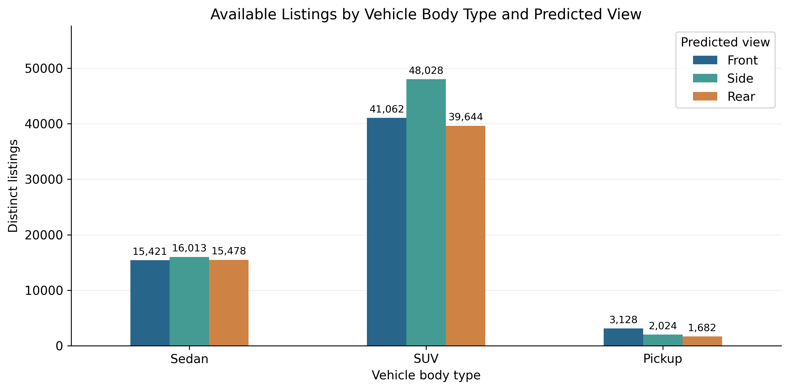
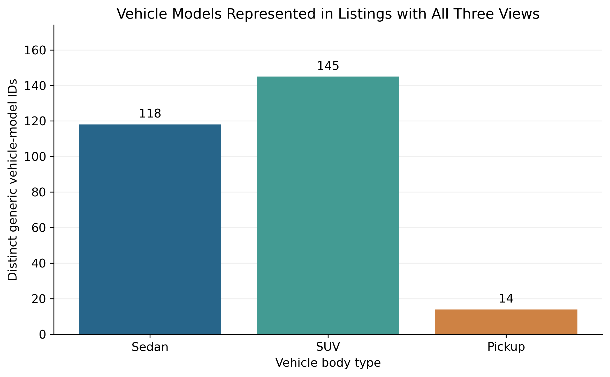

# Data Establishment

## Data Summary

DVM-CAR 2.0 provides 1,451,784 standardized, background-removed 300 × 300 vehicle images covering 899 UK-market models [1], [2]. This project joins the advertisement and image tables to select sedan (`Saloon`), SUV, and pickup photos in front (0°), side (90°/270°), and rear (180°) predicted categories. Acquisition instructions for all source files and the eventual final bundle are maintained in [DOWNLOAD_DATA.md](DOWNLOAD_DATA.md). Other source columns, such as price or mileage, are not model inputs.

Each final observation will be one approved vehicle image. Each retained advertisement must provide one approved photo for each view of the same actual vehicle. Final sample size is pending; metadata counts are candidates, not visual approvals.

## Provenance

J. Huang, B. Chen, L. Luo, S. Yue, and I. Ounis assembled DVM-CAR from automotive information sources, including online UK used-car advertisements. We obtained the source tables and image archive through the authors' project website and linked photos to advertisements using `Adv_ID` and `Genmodel_ID`. We use `Ad_table (extra).csv` (268,255 rows) and `Image_table.csv` (1,451,784 rows). The filename encodes brand, model, registration year, color, generic-model ID, advertisement number, and image index. Viewpoint labels are predictions rather than measured camera angles [2].

Our modifications are metadata validation, target/view filtering, deterministic listing sampling, image-file checks, visual exclusions, exact-pixel duplicate exclusions, and model-disjoint splits. Source files are not overwritten. All human decisions must be saved with reviewer, time, and reason. See `SCRIPTS/data_pipeline.py` for the executable transformations.

## License

The dataset remains under **Creative Commons Attribution-NonCommercial 4.0 International**: https://creativecommons.org/licenses/by-nc/4.0/ . Credit the creators, link to the source and license, identify our modifications, and restrict reuse to noncommercial purposes. The repository's MIT code license does not relicense DVM-CAR images or derived data. Final training bundles include `DATA_LICENSE.txt` with attribution and the modification notice.

## Ethical Statement

These UK used-car listings may not represent other countries, vehicles in traffic, or unrestricted photographic conditions. Pickup trucks have fewer models, so their test results may be unstable. We will not use plates or identifying details to identify vehicle owners. We will document exclusions and sample sizes rather than imply that predictions establish vehicle identity or a causal effect of angle. The final data must not be reused commercially under the dataset's noncommercial license.

## Files and Status

| File/location | Meaning |
|---|---|
| `initial/viewpoint_audit_sample.csv` | The earlier 90-image sample; blank review fields are unresolved, not approvals |
| `initial/audit_notes.md` | Qualitative audit findings, without an invented failure rate |
| `processed/README.md` | Final output contract; cleaned CSVs are generated after review |
| `../OUTPUT/eda/` | Original MI2 plots/tables, before source-failure filtering |
| `../OUTPUT/metadata_cleaning/` | Revised automated metadata outputs, before visual cleaning |

## Data Dictionary: Source and Derived Image Records

All identifiers are strings. No physical camera-angle measurement or uncertainty interval is available. Missing source quality flags mean unassessed, not passed.

| Feature | Type | Meaning and uncertainty |
|---|---|---|
| `Adv_ID` | String | Advertisement identifier linking photos; listings can contain mismatched vehicles |
| `Genmodel_ID` | String | Generic-model identifier and split group; may cover multiple body styles |
| `Bodytype` | Category | Advertisement body label; source labels can be incorrect |
| `Body_type` | Category | Derived `Sedan`, `SUV`, `Pickup`; Saloon maps to Sedan |
| `Maker`, `Genmodel` | String | Advertised make and model, shown during review; actual photo may differ |
| `Color`, `Reg_year` | String | Advertised color and registration year used for review context; not classifier features |
| `Image_ID` | String | `Genmodel_ID$$advertisement_number$$image_number`; ambiguous repeats excluded |
| `Image_name` | String | Source JPG filename; used to locate images, never as a predictor |
| `Predicted_viewpoint` | Integer category | Predicted angle code; retain 0, 90, 180, 270 only |
| `Quality_check` | Category/missing | Source `P` pass, `N` fail, or unassessed; exclude `N`, visually review retained files |
| `View` | Category | Derived Front, Side, or Rear; requires visual verification |
| `Relative_path` | String | Reconstructed source path: brand/model/year/color/filename |
| `Alternative_rank` | Integer | Candidate preference within listing/view: source pass first, then image index |
| Image pixels | RGB image | Standardized 300 × 300 exterior photo; segmentation/cropping can remove useful features |

The unused ad-table fields describe advertising dates (`Adv_year`, `Adv_month`), mileage (`Runned_Miles`), engine (`Engin_size`, `Engine_power`, `Fuel_type`), transmission (`Gearbox`), prices/tax (`Price`, `Annual_Tax`), dimensions (`Wheelbase`, `Height`, `Width`, `Length`), economy/speed (`Average_mpg`, `Top_speed`), and seating/doors (`Seat_num`, `Door_num`). They are not imputed or used in this image-only analysis. The original tables and manual remain the source for their units and definitions.

## Review and Final Manifest Dictionary

| Field | Type | Meaning |
|---|---|---|
| `Technical_ok` | Boolean | File found uniquely, decodable, and 300 × 300; does not mean correct photo |
| `Technical_reason` | String | Missing, ambiguous, unreadable, or unexpected-size reason; blank on pass |
| `Pixel_sha256` | String | SHA-256 of decoded, EXIF-oriented RGB dimensions and pixel bytes; detects exact pixel duplicates |
| `Width`, `Height` | Integer | Decoded image dimensions in pixels |
| `Decision` | Category | Human `accept` or `reject`; missing remains pending |
| `Reason` | String | Required reason for rejection; optional note for acceptance |
| `Reviewer` | String | Name entered in the review notebook |
| `Reviewed_at` | UTC timestamp | Time the decision was saved |
| `Class_id` | Integer | Fixed mapping: Sedan 0, SUV 1, Pickup 2 |
| `Path` | String | Image path relative to the extracted training bundle (`images/filename.jpg`) |
| `Split` | Category | train, validation, test; approximately 70/15/15 by whole model group |
| `Primary_body_stratum` | Category | Most common retained body type for a model, used to stratify grouped assignment; alphabetical tie break |
| Exclusion `Reason` | Category | Listing lacks an approved triplet or has duplicate pixels |

Final manifests preserve the identifiers, target, view, source labels/path, reviewed file hash/size, reviewer/time, and split. Source/queue fields not used by the model remain in the audit trail.

## Question Explored

**Do sedans, SUVs, and pickup trucks have enough images across all three viewpoints to support a matched comparison?** The original MI2 metadata pass identified 10,765 sedan, 28,667 SUV, and 580 pickup listings spanning 118, 145, and 14 generic models respectively. These findings support investigating the question but reveal much smaller pickup model coverage. The 90-photo audit then exposed partial vehicles, mislabeled views, and inconsistent identities. No dataset-wide error rate was estimated.

### Figure 1: Original MI2 viewpoint coverage

### Figure 2: Original MI2 matched model coverage

These plots reproduce the MI2 stage and must not be interpreted as final cleaned samples. The stricter automated stage excludes explicit source-failed images and ambiguous records. It yields 10,565 / 28,127 / 575 candidate listings and 118 / 144 / 13 models (Sedan / SUV / Pickup). The revised figures and counts are in `OUTPUT/metadata_cleaning/`.

## Unknowns and Mitigation

The number of usable triplets after visual review remains unknown. The cleaning notebook requires complete, correct, consistent-identity views, substitutes queued alternatives when available, and excludes incomplete listings. It then recounts models and stops if a class cannot support all three splits. Exact duplicate pixels are excluded across the approved sample; near duplicates and repeated vehicles with different photographs can remain. Generic-model grouping reduces memorization but does not prove perfect vehicle independence.

## Refinement

The research question is unchanged. We now explicitly require three complete exterior photos of the same vehicle per listing, with predicted labels used only for initial filtering. The default review sample caps listings per model to keep the manual task feasible; this is a documented sampling choice, not a statement that every source image was reviewed. Freeze the seed and sampling policy before training and report actual model and listing counts after review.

## References

See [../REFERENCES/README.md](../REFERENCES/README.md) for IEEE references [1]–[4].
